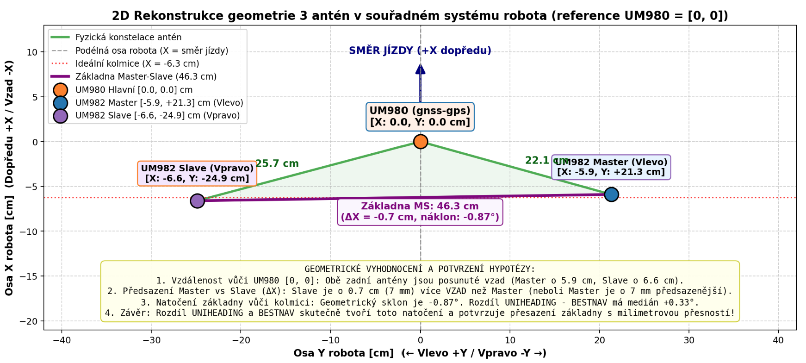
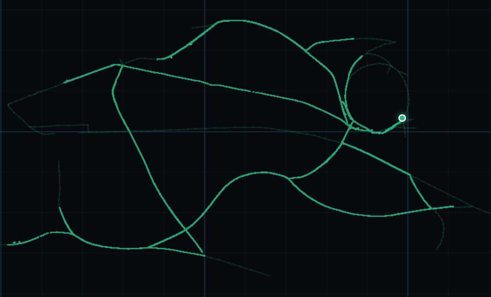
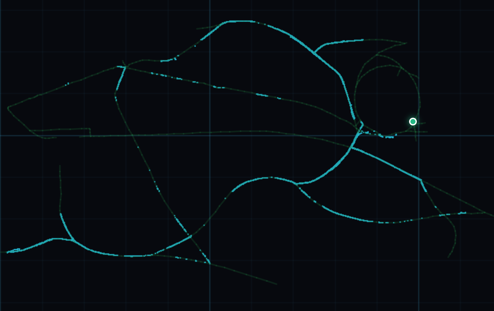
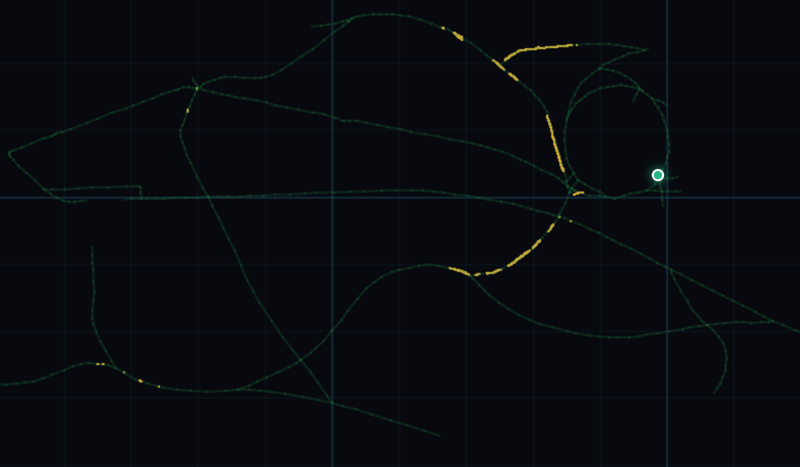
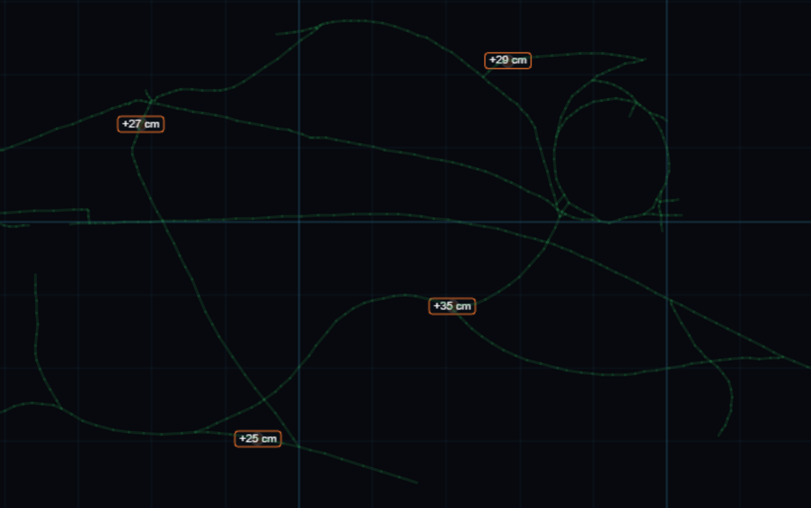
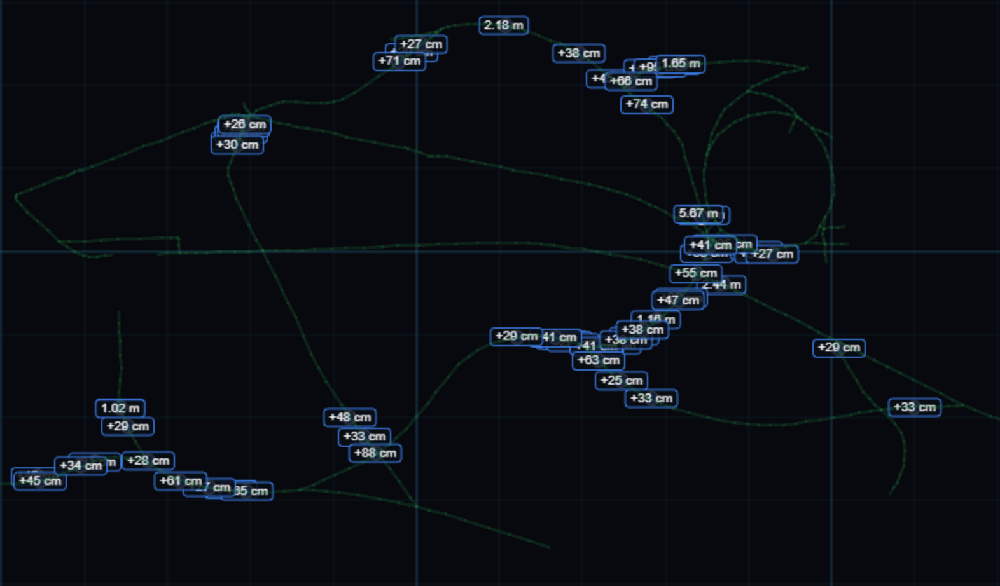
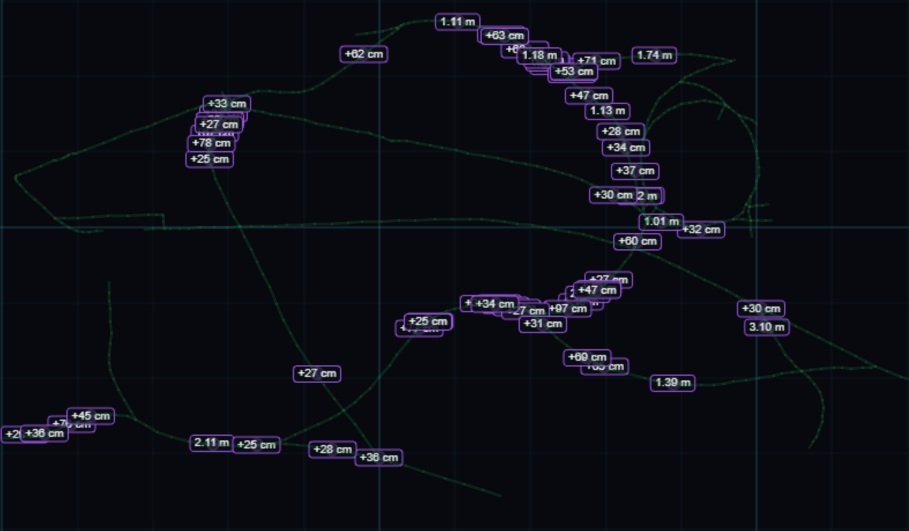
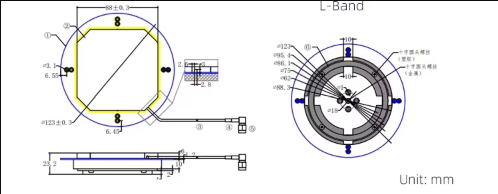
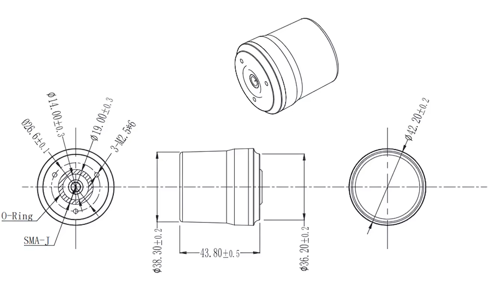

# Konstelace GNSS antén na robotu

- [Konstelace GNSS antén](#konstelace-gnss-antén)
- [Vyhodnocení stavu konstelace](#vyhodnocení-stavu-konstelace)
- [Skoky](#skoky)
- [Antény](#antény)
- [Moduly](#moduly)
- [Budoucí výzkum a možnosti vylepšení](#budoucí-výzkum-a-možnosti-vylepšení)

## Konstelace GNSS antén

GNSS řešení robota:
1. **Hlavní anténa** připojená k UNICORE UM980 
2. **Primární a sekundární anténa** připojené k duálnímu přijímači UNICORE UM982 

Primární a sekundární anténa tvořily s hlavním přijímačem konstelaci pro měření vzdáleností mezi anténami jako mechanismus pro identifikaci false fixů RTK řešení jednotlivých antén.

Díky této konstelaci bylo možné identifikovat **chybná měření polohy způsobená odrazy** signálu (tzv. multipath). Když robot jel pod stromy či v blízkosti jiného objektu, mohl nastat chybný fix, který algoritmus měřením vzdáleností mezi anténami detekoval.

## Vyhodnocení stavu konstelace

Během sobotního dne nasbíral robot cca 130 tisíc měření za zhruba 3,5 hodiny jízdy, během nichž ujel cca 8,5 km.
Za celou dobu jízd měly všechny antény platný RTK fix (s výjimkou jednoho měření na hlavní anténě). 

### Grafické znázornění stavu konstelace
**Konstelace OK** – Všechna měření vzdáleností mezi anténami odpovídají geometrii robota.

**Konstelace – 2 antény OK** – Dvě antény mají správnou vzdálenost a u třetí došlo k vyřazení.

**Konstelace – Degradace** – Žádná vzdálenost neodpovídala konstelaci. 

### Modely validace konstelace

V rámci analýzy logů se ukázaly dva zásadní nedostatky implementovaného řešení:
- Model kontroloval jen vzdálenost mezi anténami (nebyl zohledněn vliv natočení antén vůči tělu robota).
- Nebyla aplikována synchronizace epoch mezi dvěma moduly (některé validace porovnávaly novou polohu Hlavní antény s daty duálních antén starými 100 ms).

### Model 1: Původní fúze (reálný běh v ostré jízdě)
Reálný stav zaznamenaný během jízdy (pouze porovnávání vzdáleností mezi anténami).

| Stav konstelace | Čas [s] (Podíl) | Ujetá dráha [m] (Podíl) | Počet vzorků (10 Hz) |
| :--- | :---: | :---: | :---: |
| **`TRIANGLE_OK`** | 10 231.1 s (**77.53 %**) | 6 511.6 m (**76.69 %**) | 101 795 |
| **`EXCLUDED_SLAVE`** | 1 142.8 s (**8.66 %**) | 760.3 m (**8.95 %**) | 11 370 |
| **`EXCLUDED_MASTER`** | 927.5 s (**7.03 %**) | 560.8 m (**6.60 %**) | 9 229 |
| **`EXCLUDED_HLAVNI`** (UM980) | 619.0 s (**4.69 %**) | 454.1 m (**5.35 %**) | 6 159 |
| **`TRIANGLE_DEGRADED`** | 275.8 s (**2.09 %**) | 204.2 m (**2.41 %**) | 2 745 |
| **Rozpad celkem** | **2 965.3 s (22.47 %)** | **1 979.5 m (23.31 %)** | **29 504** |
| **Celkem aktivní jízda** | **13 195.9 s (100.0 %)** | **8 491.5 m (100.0 %)** | **131 299** |

### Model 2: Rozšířená teoretická fúze (geometrická validace)
Robustnější geometrická validace konstelace. Tyto validace zahrnovaly kontrolu úhlu natočení antén vůči tělu robota, ale byly testovány pouze offline na zaznamenaných datech.

| Stav konstelace | Čas [s] (Podíl) | Ujetá dráha [m] (Podíl) | Počet vzorků (10 Hz) |
| :--- | :---: | :---: | :---: |
| **`TRIANGLE_OK`** | 7 774.9 s (**58.92 %**) | 4 881.7 m (**57.49 %**) | 77 754 |
| **`EXCLUDED_SLAVE`** | 3 362.4 s (**25.48 %**) | 2 168.2 m (**25.53 %**) | 33 619 |
| **`EXCLUDED_MASTER`** | 1 018.0 s (**7.71 %**) | 674.0 m (**7.94 %**) | 10 180 |
| **`EXCLUDED_HLAVNI`** (UM980) | 138.6 s (**1.05 %**) | 109.7 m (**1.29 %**) | 1 386 |
| **`TRIANGLE_DEGRADED`** | 902.0 s (**6.84 %**) | 658.0 m (**7.75 %**) | 9 020 |
| **Rozpad celkem** | **5 421.0 s (41.08 %)** | **3 609.8 m (42.51 %)** | **54 205** |
| **Celkem aktivní jízda** | **13 195.9 s (100.0 %)** | **8 491.5 m (100.0 %)** | **131 959** |

### Porovnání obou modelů

Srovnáním je vidět:
- Častější vyloučení Sekundární antény UM982 (25 % času) – to koreluje s jejím omezením na zpracovávané frekvence (pouze L1/L2); chybí frekvence L5, která se chová lépe pod stromy.
- Snížení počtu vyloučení Hlavní antény z 5 % času na 1 % – oprava synchronizace epoch, kdy v některých případech docházelo k porovnávání nových poloh Hlavní antény s daty duálních antén starými 0,1 s.
- Celkově větší rozpad konstelace o cca 7 % (cca 0,6 z 8,5 km) – což odpovídá kontrole natočení antén vůči tělu robota. 

Četnost vyloučení Primární duální antény v porovnání s Hlavní anténou (6×) by se dala přičíst rozdílným anténám, kdy Hlavní anténa je geodetická a Primární duální anténa je šroubovicová, a to i s ohledem na minimální rozdíly ve výpočetním zpracování UM980 a UM982 na primární anténě (detailní porovnání frekvencí modulů je níže v sekci [Moduly](#moduly)).

## Skoky
Přehledová analýza skoků poloh mezi dvěma měřeními s odstupem 0,1 s. Analýza řešila skoky delší než 25 cm (2,5× větší vzdálenost než maximální rychlost robota 1 m/s).

### Histogram četnosti skoků nad 25 cm (v ostré jízdě)

| Interval skoku | Hlavní anténa | Dual Prim (Master) | Dual Sek (Slave) | 
|:---|:---:|:---:|:---:|
| **25 – 30 cm** | **3** | **18** | **14** |
| **30 – 35 cm** | **1** | **8** | **8** |
| **35 – 40 cm** | **0** | **4** | **5** |
| **40 – 50 cm** | **0** | **9** | **3** | 
| **50 – 75 cm** | **0** | **9** | **10** |
| **75 – 100 cm** *(0.75 – 1 m)* | **0** | **3** | **5** |
| **100 – 150 cm** *(1 – 1.5 m)* | **0** | **4** | **8** |
| **150 – 200 cm** *(1.5 – 2 m)* | **0** | **2** | **4** |
| **200 – 300 cm** *(2 – 3 m)* | **0** | **2** | **2** |
| **> 300 cm** *(nad 3 metry!)* | **0** | **1** | **1** |
| **CELKEM v ostré jízdě** | **4** | **60** | **60** |

### Absolutní maxima skoků mezi sousedními snímky ($dt = 0.1\text{ s}$)

* **UM980 Hlavní anténa**:
  * Maximum v ostré jízdě: **$34.7\text{ cm}$** *(Předkolo – vykládka)*
  * Nad $35\text{ cm}$ v ostré jízdě: **0 případů (žádný)**
* **UM982 Dual Prim (Master)**:
  * Maximum v ostré jízdě: **$566.5\text{ cm}$ (5.66 m)** *(2. kolo – vykládka)*
  * Nad $1\text{ metr}$: **9 případů**
* **UM982 Dual Sek (Slave)**:
  * Maximum v ostré jízdě: **$310.0\text{ cm}$ (3.10 m)** *(Předkolo – nakládka)*
  * Nad $1\text{ metr}$: **15 případů**

### Grafické znázornění skoků v mapě
**Hlavní anténa – UM980** 

**Primární duální anténa – UM982**

**Sekundární duální anténa – UM982**

## Antény
Robot používá dvě různá GNSS řešení.

### Hlavní anténa – parametry

| Parametr / Vlastnost | Hodnota |
| :--- | :--- |
| **Typ antény (Form)** | Dish antenna |
| **Architektura zářiče (Patch)** | Dual Four-point-feed, Dual Stacked Patch |
| **Pracovní frekvence** | 1154–1300 MHz / 1525–1621 MHz |
| **Podporovaná pásma** | **GPS:** L1/L2/L5 **GLONASS:** L1/L2/L3 **BDS:** B1/B2/B3 **Galileo:** E1/E5/E6 **L-band** |
| **Zisk LNA** | 40 ± 2.0 dB (typ. @ 25 °C) |
| **Špičkový zisk zářiče (Peak Gain)** | ≥ 5.0 dBi @ Fc *(v podkladech: 25.0 dBi)* |
| **Šumové číslo (Noise Figure)** | ≤ 2.0 dB @ 25 °C, typ. (Pre-filtered) |
| **Polarizace** | RHCP |
| **Axiální poměr (Axial Ratio)** | ≤ 1.5 dB |
| **Vyzařovací diagram** | 360° |
| **Impedance** | 50 Ω |
| **VSWR** | ≤ 1.5 |
| **Výstupní VSWR** | ≤ 1.8:1 (typ.), max. 2.0:1 |
| **Konektor** | MCX-J |
| **Rozměry** | 140 × 23.8 mm |
| **Hmotnost** | ≤ 235 g |
| **Materiál krytu (Radome)** | PC+PBT |
| **Napájecí napětí** | 3.0 ~ 16 V DC |
| **Odběr proudu** | ≤ 45 mA |

**Rozměry a schéma**  

### Primární a sekundární antény – parametry

| Parametr / Vlastnost | Hodnota |
| :--- | :--- |
| **Architektura zářiče** | Quadrifilar Helix (šroubovicová) |
| **Pracovní frekvence (LNA)** | 1164–1278 MHz / 1525–1615 MHz |
| **Podporovaná pásma** | **GPS:** L1/L2/L5 **GLONASS:** L1/L2/L3 **BDS:** B1/B2/B3 **Galileo:** E1/E5/E6 **L-band** |
| **Zisk LNA** | 35 ± 3.0 dB (typ. @ 25 °C) |
| **Špičkový zisk zářiče (Peak Gain)** | ≥ 2.5 dBi |
| **Šumové číslo (Noise Figure)** | ≤ 1.5 dB @ 25 °C (typ.) |
| **Skupinové zpoždění (Group Delay Variation)** | ≤ 5 ns |
| **Polarizace** | RHCP |
| **Axiální poměr v zenitu (Axial Ratio)** | ≤ 1.5 dB |
| **Vyzařovací diagram (Azimuth)** | 360° |
| **Impedance** | 50 Ω |
| **Výstupní VSWR** | ≤ 1.8:1 (typ.), max. 2.0:1 |
| **Konektor** | SMA-J |
| **Rozměry** | ⌀ 43.8 × 42.2 mm |
| **Materiál krytu (Radome)** | ABS + PC |
| **Napájecí napětí** | 3.0 ~ 6.0 V DC |
| **Odběr proudu** | ≤ 45 mA |
| **Provozní teplota** | -40 °C až +85 °C |
| **Skladovací teplota** | -45 °C až +85 °C |
| **Vlhkost** | 95 % (nekondenzující) |
| **Krytí (Waterproof)** | IP67 |

**Rozměry a schéma**  

## Moduly

GNSS moduly:
- Hlavní anténa UNICORE UM980
- Duální řešení pro Primární a Sekundární anténu UNICORE UM982
- X20D – U-blox duální GNSS 
- G5P3H – Septentrio duální GNSS

### Srovnávací tabulka modulů

| Frekvence / Signál | **UM980** | **UM982 Master** | **UM982 Slave** | X20D Master | X20D Slave | G5P3H Master | G5P3H Slave |
| --- | --- | --- | --- | --- | --- | --- | --- |
| **Schopnosti a výstupy** |  |  |  |  |  |  |  |
| Poloha (RTK k ref. stanici) | ● | ● | ● | ● | ○ | ● | ○ |
| Statický azimut (Heading)\*1 | ○ | ● | ● | ● | ● | ● | ● |
| Rychlost | ● | ● | ● | ● | ○ | ● | ○ |
| Náklon\*1 | ○ | ● | ● | ● | ● | ● | ● |
| Azimut za jízdy (COG) | ● | ● | ● | ● | ○ | ● | ○ |
| Surová data (Raw Obs) | ● | ● | ● | ● | ● | ● | ● |
| **GPS** |  |  |  |  |  |  |  |
| L1C/A | ● | ● | ● | ● | ● | ● | ● |
| L1C | ◐ | ◐ | ○ | ○ | ○ | ◐ | ◐ |
| L2C | ● | ● | ● | ● | ● | ● | ● |
| L2P(Y) | ● | ● | ◐ | ○ | ○ | ● | ● |
| L5 | ● | ● | ○ | ● | ● | ● | ● |
| **GLONASS** |  |  |  |  |  |  |  |
| G1 (L1OF / L1C/A) | ● | ● | ● | ● | ● | ● | ● |
| G2 (L2OF / L2C/A) | ● | ● | ● | ● | ● | ● | ● |
| L2P | ○ | ○ | ○ | ○ | ○ | ● | ● |
| G3 (L3 CDMA) | ◐ | ◐ | ○ | ○ | ○ | ● | ● |
| **Galileo** |  |  |  |  |  |  |  |
| E1 (E1-B/C) | ● | ● | ● | ● | ● | ● | ● |
| E5a | ● | ● | ○ | ● | ● | ● | ● |
| E5b | ● | ● | ● | ○ | ○ | ● | ● |
| E6 | ◐ | ◐ | ○ | ● | ● | ● | ○ |
| **BeiDou (BDS)** |  |  |  |  |  |  |  |
| B1I | ● | ● | ● | ● | ● | ● | ● |
| B1C | ◐ | ◐ | ○ | ● | ● | ● | ● |
| B2I | ○ | ○ | ○ | ○ | ○ | ● | ● |
| B2a | ◐ | ◐ | ◐ | ● | ● | ● | ● |
| B2b | ◐ | ◐ | ○ | ○ | ○ | ● | ● |
| B3I | ● | ● | ● | ● | ● | ● | ● |
| **QZSS** |  |  |  |  |  |  |  |
| L1C/A | ● | ● | ● | ● | ● | ● | ● |
| L1C/B | ◐ | ● | ● | ● | ● | ● | ● |
| L1C | ◐ | ○ | ○ | ○ | ○ | ◐ | ◐ |
| L2C | ● | ● | ● | ● | ● | ● | ● |
| L5 | ● | ● | ○ | ● | ● | ● | ● |
| L6 (L6D / L6E) | ◐ | ◐ | ○ | ○ | ○ | ● | ○ |
| **NavIC (IRNSS)** |  |  |  |  |  |  |  |
| L1 (L1-SPS) | ○ | ○ | ○ | ● | ● | ○ | ○ |
| L5 (L5-SPS) | ◐ | ○ | ○ | ● | ● | ● | ● |
| S (S-SPS) | ○ | ○ | ○ | ○ | ○ | ○ | ○ |
| **Korekční systémy** |  |  |  |  |  |  |  |
| SBAS (L1) | ● | ● | ○ | ● | ● | ● | ● |
| L-Band | ◐ | ◐ | ○ | ○ | ○ | ● | ● |

- Legenda: **●** = Podporuje vždy, **◐** = Závisí na zvoleném profilu, **○** = Nepodporuje.
- \*1 pouze duální moduly (UM982, X20D a G5P3H)

## Budoucí výzkum a možnosti vylepšení

Přehledová tabulka modulů ukazuje, že budoucí řešení by mohlo být postaveno na modulu G5P3H, a to z důvodů minimálního omezení přijímaných signálů. RTK poloha sekundární antény však není modulem počítána a bylo by ji třeba pro účely Loose Coupling dopočítávat na robotovi.

Alternativně by se dalo použít 3×/4× G5P3 (single anténa) či UM980 (single anténa) a dopočítávat azimut na robotovi.

Pro účely Tight Coupling se zdá být použití dvou modulů G5P3H (duální anténa) nejpřijatelnější variantou, kde by výpočet GNSS řešení byl kompletně implementován na robotovi z Raw Observable zpráv za použití MC-LAMBDA (Multi-Constrained LAMBDA), kdy rozměry robota jsou součástí řešení a vylučují se jednotlivé frekvence, nikoliv celá anténa. Takovéto řešení by mohlo udržet RTK fix i v lese v hluboké rokli.

Což je předmětem budoucího výzkumu a spolupráce :)

