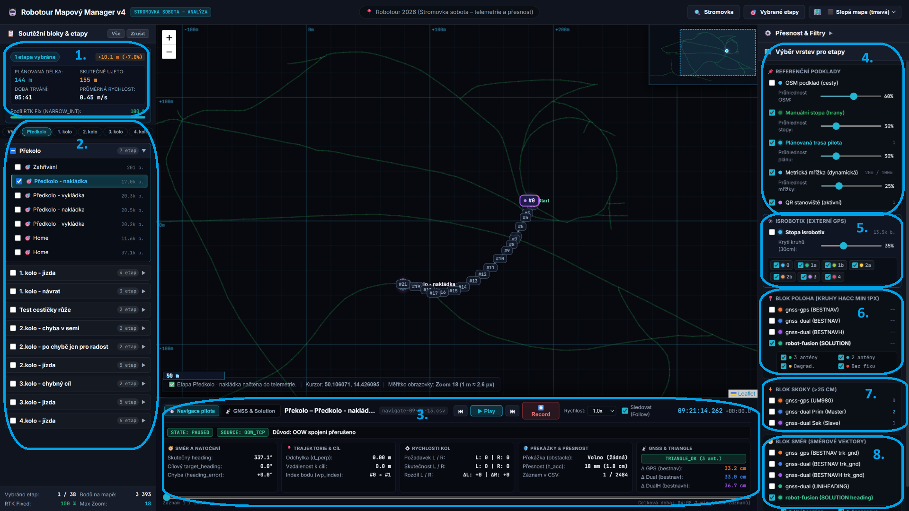
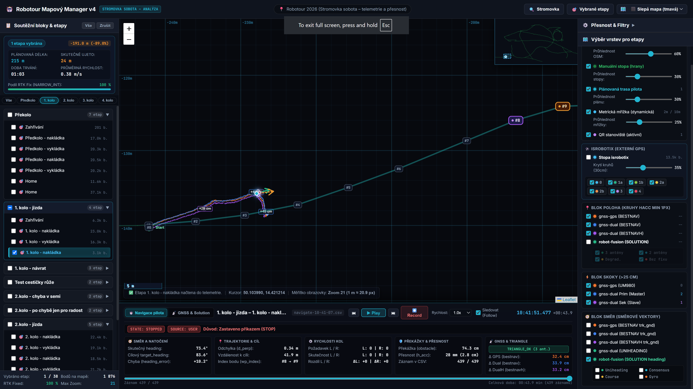
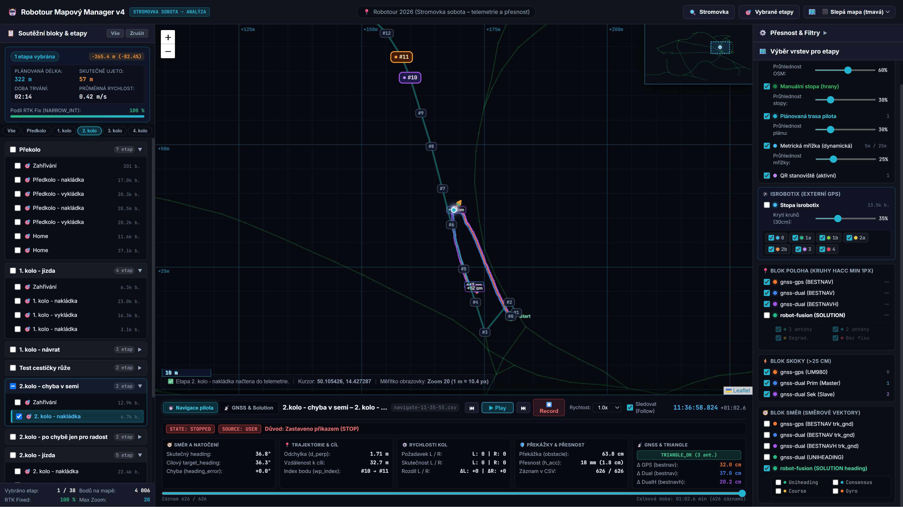
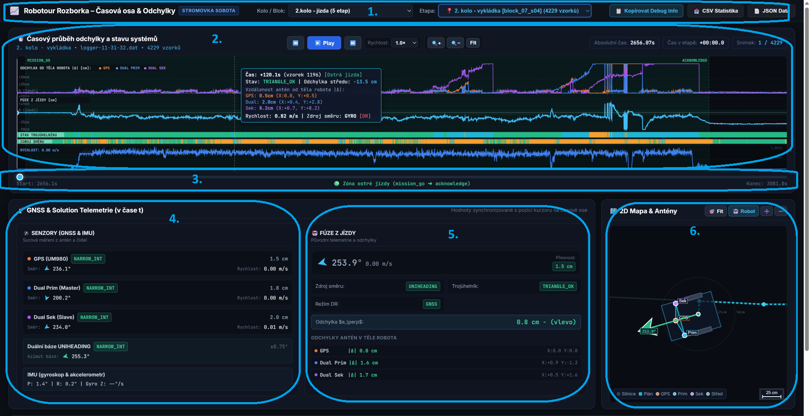
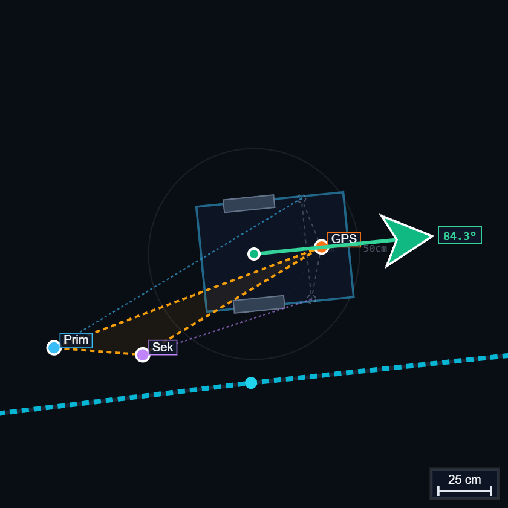
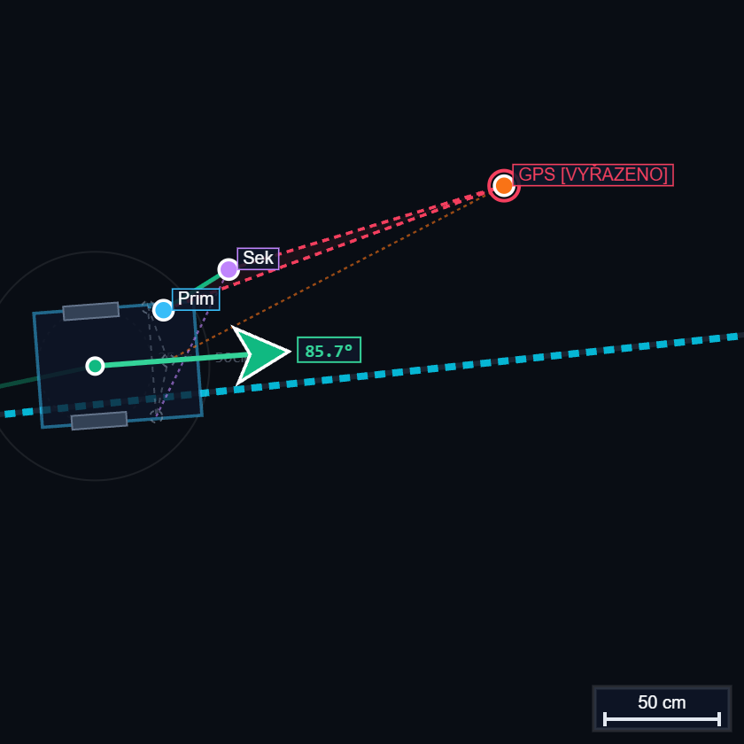
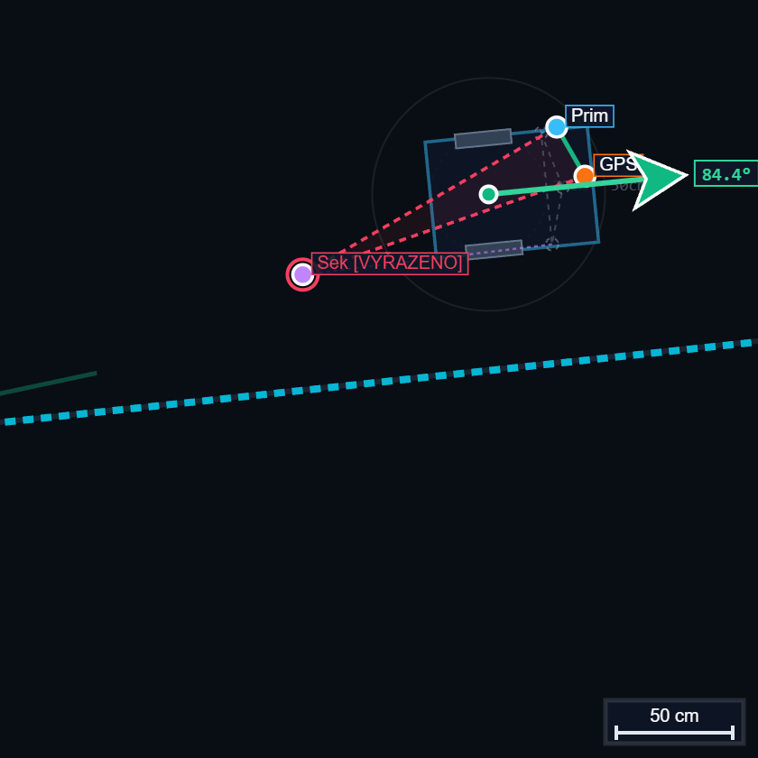
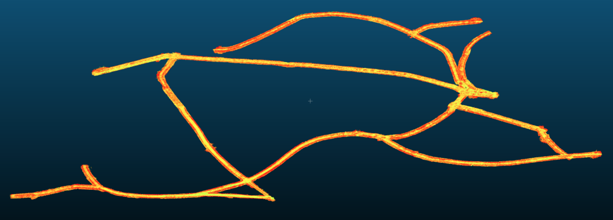
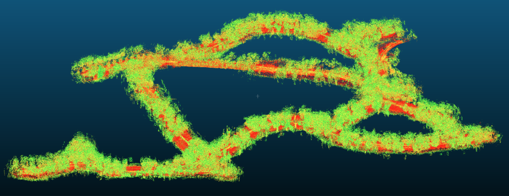

# Detailní analýza soboního dne 

* [Analytické nástroje](#analytické-nástroje)
* [Vyjetí z cesty](#vyjetí-z-cesty)
* [Časová osa](#časová-osa)
* [GNSS Data](#gnss-data)
* [3D Sken Stromovky](#3d-sken-stromovky)
* [Konstelace antén 📄](konstelace.md) 
* [F9R IMU 📄](f9r_imu.md)

## Analytické nástroje

Pro účely analýzy logů z ostré jízdy byl vyvinuty dedikované analytické nástroje, který umožňuje prohlížení a vizualizaci dat zaznamenaných robotem. Primárně GPS Trace a logy služby Pilota-Robotour.

### Mapové zobrazení
https://unidroids.com/robot-platform/gnss-trace/mapa

* 1. Sumární přehled vybraných etap (čas a vzdálenost)
* 2. Výběr etapy
* 3. Detailní stav polohy a pilota pro každý okamžik s časovým posuvníkem a možností přehrávání jízdy 
* 4. Volba podkladových vrstev (OMS, Manuální Stopa, Plánovaná Trasa, Metrická mřížka, Stanoviště)
* 5. Vrstva - ISTROBOTICS GPS Trace
* 6. Vrstva - polohy pro jednotlivé antény a robota
* 7. Vrstva - Skoky jenotlivých antén větších jak 25 cm
* 8. Vrstva - Směrové vektory antén z jízdy, duální antény, a robota

## Vyjetí z cesty

V rámci analýzi logu byla provedena detekce úseků, kde robot vyjel mimo definovanou cestu. Ve všech případech se jednalo o chybu v kódu služby PILOT-ROBOTOUR, která vznikla klonem PILOT-WAYPOINT, který obsahoval volbu počátečního úseku pro účely testování, pro případ, že by test začínal uprostřed předdefinované cesty. Tento kód měl chybu ve výběru nejbližšího úseku a navíc pro účely robotour, kde se trasa robota počítá na míru, není třeba. Tato chyba byla opravena a oprava publikována. 

### Vyjetí mimo cestu - 1. kolo (opakovaná nakládka) a 2. kolo (vyjetí v semi zóně)

## Časová osa
https://unidroids.com/robot-platform/gnss-trace/rozborka

* 1. Výběr etapy
* 2. Časově zobrazena - Odchylka antény od polohy, odchylka robota od ideální stopy, stav trojúhelníka, zdroj azimutu, rychlost robota
* 3. Časový posuvník
* 4. Deatail vstupních informací z antén a IMU
* 5. Výsledek fúze dat
* 6. Detailní zobrazení robota a poloha antén 

## False RTK Fix detekce

V rámci analýzi vyhodnocování polohy antén bylo identifikováno, že čistá vzdálenost mezi anténami pro určení antény s False RTK Fix není dostatečná. Prostřední obrázek ukazuje příklad, kdy vzdálenost mezi Duálními anténami byla v rámci tolerance, ale natočení antén vůči tělu robota se značně lišilo. Pro lepší detekci je nutné kontrolovat i úhel natočení antén vůči tělu robota. (Detaily alternativního modelu je součástí dokumentu [Konstelace antén 📄](konstelace.md) )

## GNSS Data

Pro případ zájmu jsou k dispozici logy služby GNSS (60MB) (https://unidroids.com/robot-platform/gnss-trace/gps-data-robotour-2026.zip)

Soubor obsahuje páteční gps trace, offline mapu a gps traces sobotních jízd. 

## 3D Sken Stromovky

V rámci testování byla vytvořena 3D point cloud sobotní ježdění ve Stromovce. V případě zájmu je možné ho poskytnout cca 10GB. 
* Vlevo: Ořez na cesty (0,5 cm voxelizace)
* Vpravo: Celá oblast skenování (3,0 cm voxelizace)

## Další analýzy

- [Konstelace antén 📄](konstelace.md)
- [F9R IMU 📄](f9r_imu.md)
